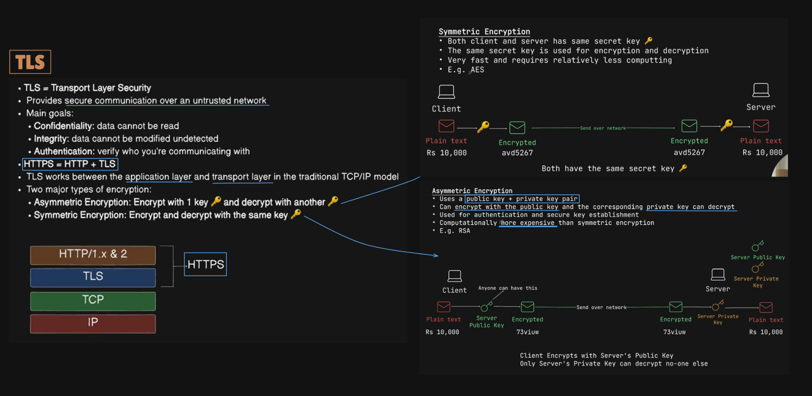
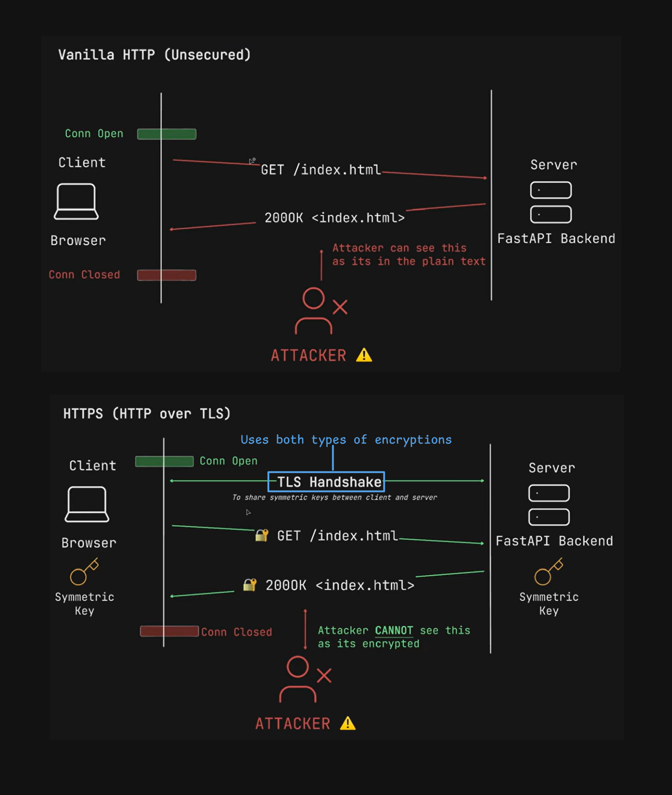

# TLS - Transport Layer Security

> [!NOTE]
> **Section:** Computer Networking - [TLS Overview](https://youtu.be/iM8Dx61uNRc?si=483JcHGJYkyi62rM)
> 
> **Learning objective:** Understand why TLS is needed, what security properties it provides, the roles of symmetric and asymmetric cryptography, and how HTTPS uses TLS to protect HTTP communication.

[← Back to Computer Networking Repository](https://github.com/Priya200227/computer-networking)

---

## 1. What Is TLS?

**TLS (Transport Layer Security)** is a cryptographic protocol that provides secure communication between two endpoints over an untrusted network.

Without TLS, data exchanged using HTTP can travel in plaintext. Anyone able to observe the traffic may be able to read it or potentially modify it.

TLS protects communication by providing three important security properties:

| Security property | Meaning |
|---|---|
| **Confidentiality** | Prevents unauthorized parties from reading transmitted data |
| **Integrity** | Helps detect whether transmitted data has been modified |
| **Authentication** | Verifies the identity of the communicating endpoint, typically the server |

### Why do we need TLS?

Consider a browser communicating with a web server using ordinary HTTP.

- The browser sends an HTTP request.
- The server returns an HTTP response.
- Without encryption, an attacker who can observe the traffic may read sensitive information.

TLS protects the communication channel so that application data is encrypted while travelling across the network.

> [!IMPORTANT]
> TLS protects data in transit. It does not automatically protect data stored on a device or server, nor does it prevent every type of attack.

## 2. HTTP vs HTTPS

**HTTPS = HTTP over TLS.**

HTTP defines how requests and responses work. TLS provides security for the communication carrying those HTTP messages.

### Traditional protocol stack

For HTTP/1.1 and HTTP/2 over TCP:

```text
       HTTP
         |
        TLS
         |
        TCP
         |
         IP
```

The combination of HTTP and TLS is commonly called **HTTPS**.

When a browser communicates with a server using HTTPS:

1. A connection is established.
2. The client and server perform a TLS handshake.
3. They establish the cryptographic parameters and session keys.
4. HTTP requests and responses are exchanged as encrypted application data.

> [!NOTE]
> HTTP/3 is different: it uses QUIC, which integrates TLS 1.3 security rather than placing TLS over TCP as in the traditional HTTP/1.1 and HTTP/2 stack.

## 3. Two Types of Cryptography

TLS uses both symmetric and asymmetric cryptographic techniques, but they serve different purposes.

### 3.1 Symmetric Encryption

In symmetric encryption, **the same secret key is used for both encryption and decryption**.

```text
Client                         Server

Plaintext
    |
    | Encrypt using secret key
    v
Encrypted data  -------------> Encrypted data
                                  |
                                  | Decrypt using same key
                                  v
                               Plaintext
```

Both endpoints must securely obtain the same secret key.

**Characteristics:**

- Uses one shared secret key.
- The same key encrypts and decrypts data.
- Efficient and fast.
- Suitable for protecting large amounts of application data.

**Example:** AES (Advanced Encryption Standard).

### 3.2 Asymmetric Cryptography

Asymmetric cryptography uses a **public key and a corresponding private key**.

- The public key can be shared.
- The private key must be kept secret.
- The two keys are mathematically related and are used in cryptographic operations.

Asymmetric cryptography supports operations such as digital signatures and key establishment.

**Characteristics:**

- Uses a public/private key pair.
- Supports authentication and secure key-establishment mechanisms.
- Generally more computationally expensive than symmetric encryption.

**Examples:** RSA and elliptic-curve cryptography.

> [!WARNING]
> A common simplified explanation says that the client encrypts all data with the server's public key and the server decrypts it with its private key. That is not how modern TLS generally protects application traffic.

### How TLS uses both

Modern TLS uses public-key cryptography during the handshake for authentication and key establishment. The client and server then derive shared symmetric traffic keys.

After the handshake, application data is protected using symmetric authenticated encryption.

This gives TLS the benefits of both approaches:

- Public-key cryptography helps establish trust and shared secrets.
- Symmetric cryptography efficiently protects application data.



## 4. How HTTPS Protects Communication

### Without TLS — HTTP

In an ordinary HTTP exchange:

1. The client sends a request such as `GET /index.html`.
2. The server sends an HTTP response.
3. The application data is not protected by TLS encryption.

An attacker able to observe the traffic may be able to read its contents.

### With TLS — HTTPS

In an HTTPS exchange:

1. The client connects to the server.
2. The TLS handshake takes place.
3. The server proves its identity using its certificate.
4. The client and server establish shared traffic keys.
5. HTTP requests and responses are transmitted as encrypted application data.

An attacker observing the network traffic cannot simply read the protected HTTP contents.



> [!IMPORTANT]
> HTTPS does not hide every piece of network information. Depending on the connection and deployment, information such as IP addresses, ports, traffic timing, and traffic volume may still be observable.

## 5. Key Takeaways

| Concept | Remember |
|---|---|
| TLS | Secures communication over an untrusted network |
| Confidentiality | Protects data from being read by unauthorized parties |
| Integrity | Helps detect data modification |
| Authentication | Verifies the identity of the server |
| HTTP | Application protocol for requests and responses |
| HTTPS | HTTP protected using TLS |
| Symmetric encryption | Same secret key for encryption and decryption |
| Asymmetric cryptography | Uses a public/private key pair |
| TLS handshake | Establishes security parameters and traffic keys |
| Application data | Protected using symmetric traffic keys |

**The core idea:** TLS secures communication by authenticating endpoints, establishing shared cryptographic keys, and protecting application data using efficient symmetric encryption.

## References

- [RFC 8446 — The Transport Layer Security (TLS) Protocol Version 1.3](https://www.rfc-editor.org/rfc/rfc8446.html)
- [RFC 9325 — Recommendations for Secure Use of TLS and DTLS](https://www.rfc-editor.org/rfc/rfc9325.html)
- [MDN — Transport Layer Security (TLS)](https://developer.mozilla.org/en-US/docs/Web/Security/Transport_Layer_Security)

---

**Next topic:** [TLS Certificates Explained in Depth](../29-tls/tls-certificates/README.md)

