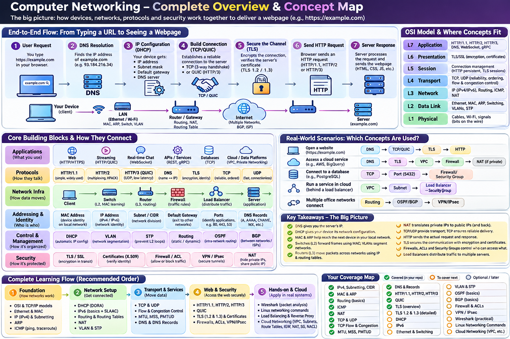

# Computer Networking - From Fundamentals to Protocol Internals

A structured, practical journey through computer networking - from understanding how devices communicate to exploring the protocols and infrastructure that power modern applications.

This repository contains **technical notes, diagrams, protocol breakdowns, practical examples, and curated learning resources** developed while studying computer networking.

The objective is not simply to memorize networking terminology. It is to understand:

- How devices communicate within and across networks.
- How data travels from an application to a remote server.
- How protocols such as TCP, UDP, DNS, HTTP and TLS work.
- How cloud networks and application infrastructure are organised.
- How networking concepts support backend systems, distributed applications and data engineering.

---

## Learning Roadmap

The repository is organised into eight subject-based modules.

|  | Module | Topics covered |
|---|---|---|
| 01 | [Network Fundamentals](./01-network-fundamentals/) | Network types, network architecture, topologies, networking devices, Ethernet switching, VLANs and firewalls |
| 02 | [IP Addressing & Routing](./02-ip-addressing-and-routing/) | IPv4, IPv6, subnetting, CIDR, subnet masks, MAC addresses, ARP, gateways, routing, ICMP, NAT and DHCP |
| 03 | [Transport Layer](./03-transport-layer/) | TCP, UDP, ports, sockets, sequence numbers, acknowledgements, reliability, flow control and congestion control |
| 04 | [DNS](./04-dns/) | DNS architecture, hierarchy, resolution, caching and DNS record types |
| 05 | [HTTP & Web](./05-http-and-web/) | HTTP fundamentals, request-response structure, HTTP/1.1, HTTP/2, multiplexing, HPACK, QUIC and HTTP/3 |
| 06 | [Security](./06-security/) | TLS, encryption, digital certificates, certificate authorities and secure connection establishment |
| 07 | [Cloud Networking](./07-cloud-networking/) | Virtual Private Cloud (VPC), subnets, route tables, Internet Gateway and cloud network isolation, security groups |
| 08 | [Application Traffic & Reliability](./08-application-traffic-and-reliability/) | Proxies, reverse proxies, load balancing, connection pooling and timeouts |

---

## What You'll Learn

### 01. Network Fundamentals

Understand the basic architecture of computer networks and how devices connect and communicate.

Topics include:

- What is computer networking?
- Network types: PAN, LAN, MAN and WAN
- Network topologies
- Ethernet and Wi-Fi
- Networking devices:
  - Switches
  - Routers
  - Access points
- Layer 2 and Layer 3 switching
- Ethernet switching and MAC address tables
- VLANs and network segmentation
- Network architecture:
  - Access layer
  - Distribution layer
  - Core layer
  - Two-tier and three-tier designs
- Firewalls and network traffic filtering
- Forward proxies and reverse proxies

[Explore Network Fundamentals →](./01-network-fundamentals/)

### 02. IP Addressing & Routing

Understand how devices are identified and how packets travel between networks.

Topics include:

- IPv4 addressing
- Network and host portions
- Subnet masks and CIDR notation
- Subnetting and VLSM
- Default gateways
- MAC addresses
- ARP and ARP tables
- IP addressing vs MAC addressing
- Routing and packet forwarding
- Routing tables
- Longest-prefix matching
- ICMP, ping and traceroute
- Network Address Translation (NAT)
- IPv4 packet structure and fragmentation
- DHCP and the DORA process
- IPv6 fundamentals

[Explore IP Addressing & Routing →](./02-ip-addressing-and-routing/)

### 03. Transport Layer

Understand how applications exchange data across different devices and how reliable delivery works.

Topics include:

- UDP and TCP
- TCP three-way handshake
- TCP connection termination
- TCP sequence and acknowledgement numbers
- TCP segment structure
- MTU, MSS and Path MTU Discovery
- Stop-and-wait
- TCP flow control
- Sliding window and window scaling
- TCP congestion control
- Retransmission timeout (RTO)
- Duplicate acknowledgements
- Explicit Congestion Notification (ECN)

[Explore Transport Layer →](./03-transport-layer/)

### 04. DNS

Understand how domain names are resolved into IP addresses.

Topics include:

- DNS architecture and hierarchy
- Root, TLD and authoritative name servers
- Recursive and iterative resolution
- DNS caching
- DNS over UDP and TCP
- Common DNS record types:
  - A and AAAA
  - CNAME
  - MX
  - NS
  - TXT
  - PTR

[Explore DNS →](./04-dns/)

### 05. HTTP & Web

Understand how browsers and web applications communicate with servers and how HTTP has evolved.

Topics include:

- What happens when an HTTP request is made?
- HTTP fundamentals
- HTTP request and response structure
- HTTP/1.0 and HTTP/1.1
- Connection reuse and pipelining
- HTTP/1.1 head-of-line blocking
- HTTP/2 binary framing
- Multiplexing and streams
- HPACK header compression
- HTTP/2 head-of-line blocking
- QUIC protocol overview
- HTTP/3 and QUIC streams
- HTTP over TCP vs HTTP over QUIC

[Explore HTTP & Web →](./05-http-and-web/)

### 06. Security

Understand how communication is protected when data travels across untrusted networks.

Topics include:

- TLS fundamentals
- Symmetric and asymmetric encryption
- Digital certificates and X.509
- Certificate authorities
- Certificate chains and trust
- Certificate generation and verification
- TLS 1.2 handshake
- TLS 1.3 handshake

**Note:** SSL is the legacy predecessor of TLS. Modern secure communication uses TLS rather than SSL.

[Explore Security →](./06-security/)

### 07. Cloud Networking

Understand how networking concepts are implemented in public cloud environments.

Topics include:

- Cloud networking fundamentals
- What is a Virtual Private Cloud (VPC)?
- VPC isolation and logical network segmentation
- Public and private subnets
- VPC CIDR ranges
- Route tables
- Internet Gateway (IGW)
- How resources communicate within a VPC
- Public and private network access

The focus is on understanding the networking architecture behind cloud-hosted applications, rather than learning every cloud networking service in depth.

[Explore Cloud Networking →](./07-cloud-networking/)

### 08. Application Traffic & Reliability

Understand how application traffic is directed, distributed and managed in backend systems.

Topics include:

- Forward proxies and reverse proxies
- Reverse proxy in application architecture
- Load balancers and traffic distribution
- Connection pooling
- Database connection management
- Timeouts and failure handling

These concepts connect networking fundamentals with the way modern backend applications communicate with databases, services and other infrastructure components.

[Explore Application Traffic & Reliability →](./08-application-traffic-and-reliability/)

---

## How the Concepts Connect

Networking concepts are easier to understand when viewed as one complete application workflow.

Consider opening a website in your browser:

1. **Network access:** Your device connects to a network using Ethernet or Wi-Fi and receives network configuration through DHCP.
2. **DNS resolution:** The browser resolves the domain name into an IP address.
3. **Connection establishment:** TCP or QUIC establishes the transport connection, with TLS providing security for HTTPS.
4. **Packet delivery:** IP addressing, routing, gateways, MAC addresses and switches help deliver data across networks.
5. **Cloud infrastructure:** The request reaches cloud-hosted infrastructure through the relevant network and security controls.
6. **Application traffic management:** Reverse proxies and load balancers direct requests to appropriate backend services.
7. **Backend processing:** Application servers communicate with databases and other services, using connection pools and timeouts to manage resources and failures.
8. **Response delivery:** The response travels back to the client, where the browser processes and renders the content.

This workflow connects the individual topics covered throughout this repository.

---

## How the Notes Are Structured

Each topic is designed to work as an independent learning resource.

Depending on the subject, a topic may include:

- **Concept explanations:** What a protocol, component or networking mechanism does.
- **Architecture diagrams:** Visual explanations of network structures and communication flows.
- **Protocol internals:** Headers, fields, important mechanisms and state transitions where relevant.
- **Practical examples:** Real-world scenarios connecting theory to applications and cloud infrastructure.
- **References:** Official documentation, RFCs, technical specifications and learning resources.

The depth of each topic is intentionally focused on practical understanding rather than specialist network engineering.

---

## Learning Resources & References

The notes are developed using a combination of structured video lessons, official documentation and Internet standards.

Some primary references include:

- [RFC Editor](https://www.rfc-editor.org/) - Internet protocol specifications.
- [IETF Datatracker](https://datatracker.ietf.org/) - Internet standards and working-group documents.
- [MDN Web Docs](https://developer.mozilla.org/) - HTTP and web technology documentation.
- [AWS Documentation](https://docs.aws.amazon.com/) - Cloud networking and VPC concepts.
- [Computer Networking - Chai aur Code](https://www.youtube.com/@chaiaurcode) - Video-based learning resource.

Relevant RFCs, official documentation and video resources are linked within individual topic notes wherever applicable.

---

## Why This Repository?

Networking is a foundational part of modern software systems.

Understanding it helps explain:

- How backend applications communicate.
- How APIs exchange data across networks.
- How cloud infrastructure connects application components.
- How databases and services communicate.
- How distributed systems handle communication, reliability and failures.
- How data engineering platforms operate across networked infrastructure.

This repository is intended to be a practical technical reference for understanding networking beyond surface-level definitions.

**Understand the architecture. Follow the request. Connect the concepts.**
